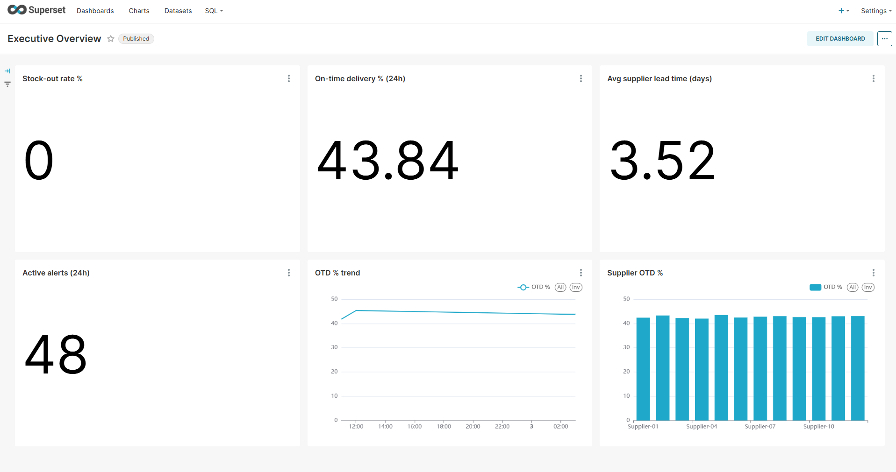
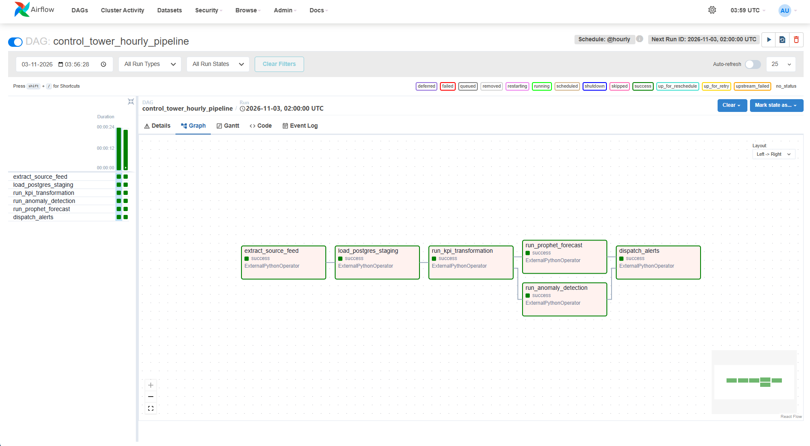
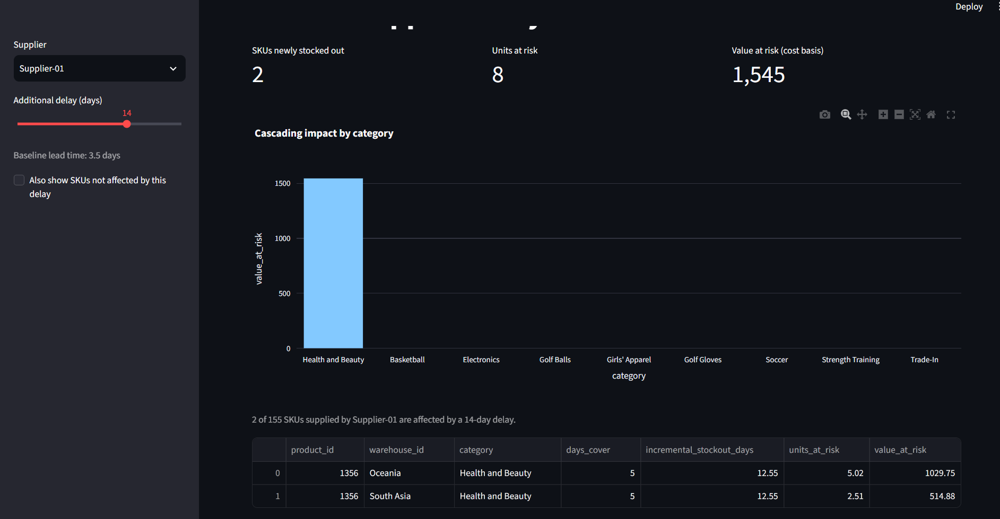
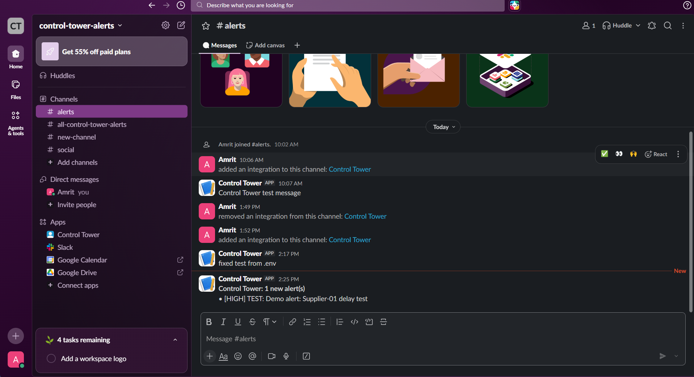

# Retail & Supply Chain Control Tower

Near-real-time visibility into inventory, deliveries and suppliers: an hourly Airflow pipeline on PostgreSQL with KPIs,
anomaly detection, Prophet demand forecasting and inventory runway, Superset dashboards, a Streamlit What-If panel,
and Slack/email alerting. See `docs/ERD.md` (ERD + pipeline flow), `docs/DATA_DICTIONARY.md`, `docs/DEMO_SCRIPT.md`,
`docs/EMAIL_ALERTS.md` and the final deck in `docs/presentation/`.

## Screenshots
| Executive dashboard (Superset) | Pipeline run (Airflow) |
|---|---|
|  |  |

| What-If panel (14-day delay) | Alert in Slack |
|---|---|
|  |  |

## Dataset decision (read this)
**DataCo Smart Supply Chain** is the dataset, but it does **not** contain a supplier entity or an inventory feed. This
project therefore: (a) *derives* 12 suppliers by deterministic bucketing of products, (b) *simulates* inventory and
hourly deltas from observed demand, (c) assumes unit cost = 70% of list price, and (d) *rebases* DataCo's 2015-18 dates
to end yesterday. Treat supplier-level results as a demonstration of the system, not findings about real suppliers.
This is why the per-supplier bars in the dashboard look alike. The same pipeline runs on the 180,519 real DataCo
shipments; if `data/DataCoSupplyChainDataset.csv` is absent (or with `--synthetic`) a synthetic dataset with DataCo's
columns is used. Download DataCo from Mendeley or Kaggle (login required) and place the main CSV in `data/`.
On DataCo's own definition about 42% of deliveries are on time, which is normal for this dataset.

## Quick start
```bash
cp .env.example .env                          # on Windows PowerShell: copy .env.example .env
docker compose up -d postgres                 # applies sql/schema.sql + Superset views
docker compose run --rm ingest                # python -m src.ingest_data  (add --synthetic if no CSV)
docker compose up -d --build airflow superset whatif
python scripts/superset_bootstrap.py          # Executive Overview dashboard (needs: pip install requests)
python scripts/superset_bootstrap_extra.py    # Inventory Health + Supplier Performance dashboards
```
Airflow `:8080` (user `admin`, password in `/opt/airflow/standalone_admin_password.txt` inside the container),
Superset `:8088` (`admin` / `admin`), What-If `:8501`. Switch the DAG `control_tower_hourly_pipeline` on and trigger it once.
Without Docker: `pip install -r requirements.txt`, point `DATABASE_URL` at a Postgres with `sql/schema.sql` applied,
`python -m src.ingest_data`, then `python -m src.run_local --hours 24 --start "<ts after last inventory row>"`.
`DEMO_ANOMALIES=1` injects delays and spikes so alerts fire. Tests: `python -m pytest -q` (26 tests).

### Operating notes (Windows / Docker Desktop)
* Containers stop when Docker Desktop closes or the PC sleeps; `docker compose up -d` restarts them. Never run
  `docker compose down -v`: it deletes the database volume.
* Recreating the Airflow container (`--force-recreate`) resets its login and run history (SQLite metadata, stored in
  the container) but not your data in Postgres. Fetch the new password and sign in from a private window, because the
  old session cookie causes "CSRF session token is missing".
* If the Airflow page stays down, its web server may have timed out starting; `docker compose restart airflow` and wait ~3 min.
* `.env` must contain the Slack webhook URL **once**, starting `https://hooks.slack.com/services/T...` (81 characters).
  A doubled prefix made Slack answer with an HTML page, which looked like success until delivery was made to require `ok`.

## Design choices
* SKU = product x warehouse. KPI formulas live in `src/kpis.py` as pure functions; SQL only fetches data.
* Delay anomalies: per-supplier mean/std from deliveries *before* the current hour, so a fresh outlier can't mask itself.
* Demand spikes: 24h buckets aligned to the run time (trailing 24h vs the prior 28), so an hourly run never compares a
  partial day to full days. Requires mean >= 3 and lift >= 8 units: plain 3-sigma on low-count demand produced ~5x more false alerts.
* On-time-delivery alert: compares the hourly rate with the trailing 30-day baseline (drop >= 10 points and a binomial
  z-score >= 2). A fixed 90% rule would fire every hour on DataCo. `OTD_ALERT_MODE=fixed` restores it.
* Forecast: Prophet for the 40 largest category x region series, seasonal-naive for the long tail and as a fallback;
  refit every 24h, runway recomputed hourly from the stored forecast.
* Alerts: a unique `dedup_key` makes reruns safe; one digest per run; a channel failing does not block the other. Slack
  delivery requires the reply `ok`, so a bad webhook fails visibly and alerts stay queued for the next run.
* Airflow pins SQLAlchemy 1.4 while the pipeline needs 2.x, so tasks run in an isolated venv (`PIPELINE_PYTHON`) through
  `ExternalPythonOperator` (see `Dockerfile.airflow`). Harmless `pendulum` / `apache-airflow` metadata tracebacks in task
  logs do not affect results.
* `dim_products.supplier_id` was added (not in the brief) to model supplier -> product dependency for the What-If panel.

## Dashboards
`scripts/superset_bootstrap.py` builds *Executive Overview* from the `v_*` views (verified working). The extra script adds
*Inventory Health* (`v_inventory_health`) and *Supplier Performance* (`v_supplier_performance`); it is idempotent and was
written from the API docs. If a chart fails, build it by hand from those datasets. The What-If panel is the Streamlit app.

## Verified vs. not verified
**Verified on the author's machine** (Windows, Docker Desktop): ingestion of the real DataCo CSV (180,519 rows, none
dropped); the full Docker stack; hourly Airflow runs with all six tasks succeeding; Prophet forecasts; the Executive
Overview dashboard; the What-If app; Slack delivery of real detections; 26 automated tests.

**Not verified**
* email delivery against a real provider (only a mock SMTP server was used; see `docs/EMAIL_ALERTS.md`)
* `scripts/superset_bootstrap_extra.py` against a live Superset (control flow tested against a stub only)
* forecast accuracy on the real data (an earlier backtest on synthetic data showed only a small gain over the baseline)
* behaviour at scale: runs used about 1,500 SKUs
