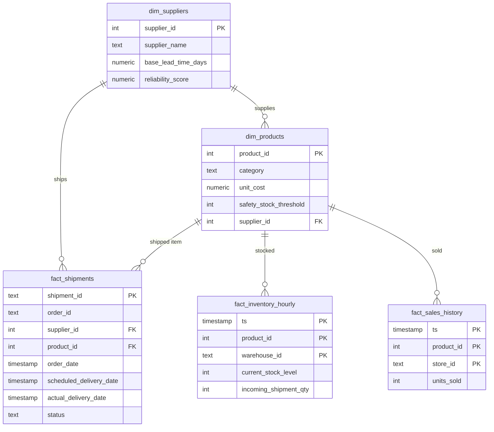
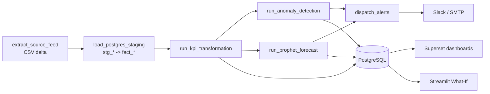

# Entity-Relationship Diagram

Derived/output tables (no FKs): `alerts_log`, `kpi_snapshot`, `kpi_doi`, `demand_forecast`, `inventory_runway`.
`store_id` and `warehouse_id` share one value space (DataCo `Order Region`) so demand joins to inventory.

# Pipeline flow

